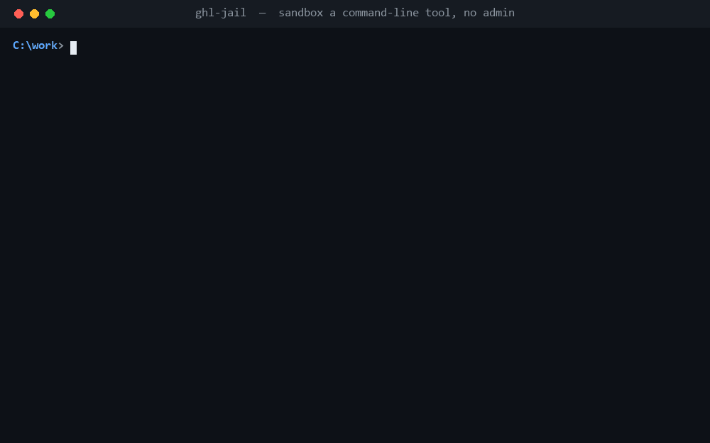

# ghl-jail



Run a command-line tool so that it **cannot read your secrets or your files** — only the one project folder you point it at.
No administrator rights, no install, no background service. Just Python 3 and Windows.

It exists for a simple, real problem: you install or run a CLI tool — a package manager, an AI coding agent, a script someone
sent you — and that tool runs with *your* full account. It can read `~/.ssh`, your cloud credentials, your browser profile,
your `.env` files, and it can phone home. In April 2026 a [malicious build of the Bitwarden
CLI](https://www.paloaltonetworks.com/blog/cloud-security/bitwardencli-supply-chain-attack/) was live on npm for about
ninety minutes, reading SSH keys, `.env` files and AWS/Azure/GCP credentials off every machine that installed it; in
October the [official OVHcloud CLI's
repository](https://www.thestack.technology/ovhcloud-cli-repo-compromised-customer-reports-incident/) was briefly
compromised the same way, caught and blocked in 94 minutes. Neither was a virus you could have spotted — just a trusted
tool with one bad update. `ghl-jail` is the fence you put around such a tool *before* you trust it.

> **This is harm reduction, not a vault.** It raises the cost of a mistake a lot. It is not proof against an attacker who is
> actively targeting this specific sandbox. Do not run known-malicious code and assume you are safe.

---

## Install

Nothing to install. You need Python 3.8+ (already on most dev machines) and Windows 10 or 11. Copy the `ghl-jail` folder
anywhere and run it.

## Use it

```
python ghl_jail.py run [options] -- <the command you want to sandbox>
```

Everything after `--` is the command, run exactly as you would in a terminal. Three things to know:

| Option | What it does | Default |
|---|---|---|
| `--project DIR` | The **only** folder the tool can write to and freely read. | the current folder |
| `--mode auto\|container\|token` | How tight the fence is (see below). | `container` |
| `--net none\|internet\|lan` | Whether the tool can reach the network (container mode only). | `none` |

Two more when you need them: `--allow-read PATH` opens one extra folder for reading only; `--keep-env NAME` lets one
environment variable (say an API token the tool genuinely needs) through the otherwise-stripped environment.

When you are done, `python ghl_jail.py cleanup` removes every permission the tool granted and deletes its scratch folder.
(A normal run cleans up after itself; `cleanup` is the belt-and-braces command.)

### The three modes, in plain terms

- **`container`** — the tightest. The tool is walled off from the whole machine except your project folder, **and it has no
  network**. Best for anything that only needs to touch your code: linters, formatters, build steps, a script you don't trust.
- **`token`** — slightly looser, and it **does not block the network**. Use it for tools that genuinely need to reach out
  (installing packages) or that refuse to start under the tightest mode (git is one). It still blocks all your other files.
- **`auto`** — you don't choose. It uses `container` for everything, and quietly switches to `token` only for the few tools
  known to need it (today: git), printing a one-line notice when it does. This is the one to use if you don't want to think.

### What the sandbox blocks and allows (verified by the test suite)

| The tool tries to... | `container` | `token` |
|---|---|---|
| read/write your project folder | allowed | allowed |
| read `~/.ssh`, `~/.aws`, `.env`, browser data, the rest of your profile | **blocked** | **blocked** |
| write anywhere outside the project | **blocked** | **blocked** |
| reach the network | **blocked** (unless `--net`) | allowed |
| read an API token you left in an environment variable | **blocked** | **blocked** |
| run python, java, node | yes | yes |
| run git | no (Windows quirk below) | yes |

---

## Three ways people use it

### 1. Run an untrusted or just-downloaded CLI tool

You got a CLI from the internet — a release binary, a `pip`/`npm` global tool, an installer script. You want to try it
without betting your SSH keys and cloud tokens on it being honest.

```
python ghl_jail.py run --project C:\scratch -- suspicious-tool.exe --do-its-thing
```

- **Alcance:** the tool sees an empty scratch folder and nothing else of yours; no network to exfiltrate to.
- **Impacto:** a backdoored tool like the OVHcloud CLI case finds no credentials on disk and no way out.
- **Diferencial:** antivirus asks "is this file *known* bad?" and waves through anything new. A VM or Docker Desktop would do
  the job but needs Pro/Hyper-V, gigabytes, and minutes to boot. `ghl-jail` is a one-line wrapper that starts instantly and
  works on Windows Home with no admin rights.

### 2. Keep an AI coding agent inside the repo it's working on

You let an AI agent (or any autonomous script) edit code and run commands in your repo. You want it to touch *that repo* and
nothing else — not your other projects, not your dotfiles — and not to call out to the network unless you say so.

```
python ghl_jail.py run --project C:\work\my-repo --net none -- agent --task "refactor the parser"
```

- **Alcance:** the agent reads and writes only `my-repo`; a stray `rm` or a bad path can't reach your other folders, and it
  can't read a token sitting in another project.
- **Impacto:** the blast radius of a confused or prompt-injected agent is one repository you can `git reset`, not your whole
  account.
- **Diferencial:** the agents that *do* ship a Windows sandbox (OpenAI's Codex) only sandbox *themselves*. `ghl-jail` is
  agent-agnostic — it wraps whatever agent, script, or tool you hand it, the same way every time.

### 3. Install dependencies without handing over your npm/pip credentials

`npm install` and `pip install` run arbitrary install scripts from strangers, and they run as you, with your registry tokens
in the environment. Here the tool needs the network but still should not read your home folder or your real tokens.

```
python ghl_jail.py run --project C:\work\app --mode token --net internet -- npm install
```

- **Alcance:** install scripts can reach the registry and write into the project's `node_modules`, but your `~/.ssh`,
  `~/.aws`, and any secret you didn't explicitly pass with `--keep-env` stay invisible.
- **Impacto:** a malicious post-install script (the npm supply-chain attack pattern) cannot read credentials off your disk or
  your environment.
- **Diferencial:** lockfile checkers and `npm audit` tell you about *known* bad packages after the fact. This contains the
  install itself, including a brand-new malicious package no scanner has flagged yet.

---

## Known limitations (so you are not surprised)

- **git only runs in `token`/`auto` mode.** git opens the `NUL` device by name on every command, and on this Windows build
  the device's permissions do not include sandboxed apps, which only an administrator could change. `auto` handles this for
  you and tells you it switched (so you know git's run was not network-isolated).
- **`token` mode does not restrict the network,** and it can still read files that are world-readable (e.g. another drive with
  default permissions). It protects your profile — where credentials live — not every file on the machine.
- **npm (and other `.cmd` tools) need `token` mode when your toolchain is inside your user profile,** because the sandbox
  can't traverse your profile folders to read the wrapper script. A toolchain under `C:\Program Files` is reachable in
  `container` mode. Plain `node` works in both.
- **Not covered:** kernel-level enforcement, Windows Sandbox/Hyper-V isolation, and Windows 11 agent features are out of scope
  by design — this is a no-admin, no-driver, user-space tool.

## Run the tests

```
python test_ghl_jail.py
```

46 tests across the three modes launch the real tools (python, java, node, git, npm) against fake decoy files and confirm
each wall holds. Every "it's blocked" test has a matching "it's allowed" test, so a typo can't masquerade as a denial.
